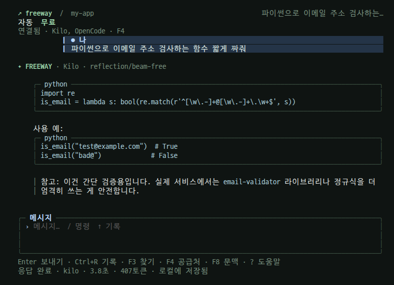

# Freeway

개인 PC에서 본인의 모델 API·공식 CLI 계정을 연결하는 오픈소스 Go 클라이언트입니다.

네이티브 패키지에는 TUI, 로컬 Go 게이트웨이, 공급처 관리 도구, 설치·업데이트 기능이 포함됩니다. 제품 실행에 Node.js가 필요하지 않습니다.



설치 직후 가입이나 키 없이 Kilo 게스트로 대화할 수 있습니다. 다른 공급처는 F4에서 본인 API 키를 등록하거나 공식 CLI로 로그인해 추가합니다.

## 설치

[GitHub Releases](https://github.com/wooinwoo/freeway-cli/releases)의 최신 릴리스를 사용합니다. Go와 Node.js는 필요하지 않습니다.

**Windows:** 일반 PC는 `Freeway-Setup-x64.exe`, Windows on Arm은 `Freeway-Setup-arm64.exe`를 받아 실행하세요. 설치를 누르면 시작 메뉴에서 Freeway를 열 수 있습니다. 관리자 권한이 필요하지 않습니다. 설치 파일은 코드 서명이 없어서 "Windows의 PC 보호" 화면이 뜰 수 있습니다. **추가 정보** → **실행**을 누르세요.

**Linux·macOS:** 설치 스크립트를 받아 실행합니다. 스크립트가 OS·CPU를 감지하고 최신 릴리스의 `SHA256SUMS`와 압축 파일을 받아 검증한 뒤 `~/.freeway/app`에 설치합니다. `curl`, `tar`, `sha256sum` 또는 `shasum`이 필요합니다. 설치 스크립트가 셸 설정 파일(`~/.bashrc`, `~/.zshrc` 등)에 PATH를 추가하므로 새 터미널을 열고 `freeway`를 실행하면 됩니다. PATH를 직접 관리하려면 `--no-modify-path`를 붙이세요.

```sh
curl -fsSLO https://raw.githubusercontent.com/wooinwoo/freeway-cli/main/install.sh
bash install.sh
```

Windows PowerShell에서도 같은 방식으로 [install.ps1](install.ps1)을 받아 `powershell -NoProfile -ExecutionPolicy Bypass -File .\install.ps1`로 설치할 수 있습니다. 릴리스 파일은 `freeway_<버전>_<os>_<arch>.tar.gz`(Windows는 `.zip`), 설치 파일 2종, `SHA256SUMS`, `release.json`과 서명 `release.json.sig`로 구성됩니다. 내려받은 압축 파일을 직접 설치하는 방법과 사용자 지정 폴더는 [설치 안내](docs/site/src/content/docs/ko/docs/installation.mdx)를 참고하세요.

### 소스에서 설치

Go 1.26 이상이 필요합니다. 저장소 체크아웃에서 실행합니다.

```sh
bash install.sh --source
```

Windows: `powershell -NoProfile -ExecutionPolicy Bypass -File .\install.ps1 -Source`.

설치 후 `freeway`를 실행하면 로컬 게이트웨이가 자동으로 시작됩니다. `freeway continue`로 작업을 이어갈 수 있습니다. [게이트웨이 연결 안내](docs/site/src/content/docs/ko/docs/gateway.md)

```sh
go -C cli run ./cmd/freeway --preview
go -C cli run ./cmd/package --root "$PWD"
```

첫 명령은 계정 없이 TUI를 미리 봅니다. 두 번째는 `dist/native`에 OS·CPU별 실행 파일, 라이선스, 파일 명세와 체크섬을 묶습니다. 릴리스를 외부에 공개하지는 않습니다.

```text
cli/       Go TUI, 인증된 HTTP 클라이언트, 제품 업데이트·패키징
backend/   로컬 게이트웨이, 공급처 연동, 대화·사용량 저장
api/       백엔드 구현에 사용할 HTTP·SSE API v1 계약
docs/site/ Astro + Starlight 정적 문서 사이트
tests/     빌드된 실행 파일의 사용자 흐름 검사
POC/       기존 Node.js 구현 보관; 네이티브 제품에 미포함
```

[CLI 사용법](cli/README.md) · [전체 구조](docs/development/architecture.md) · [개발 참여](CONTRIBUTING.md) · [완료 조건과 백엔드 인계](docs/development/client-delivery.md)

[공급처 사용법](backend/internal/providers/README.md) · [공급처 API](backend/internal/providers/API.md) · [제품 패키징](scripts/package/README.md) · [공식 공급처 CLI 설치](scripts/install/README.md)

## 공급처 이용 조건

Freeway는 사용자가 직접 연결한 계정과 API 키로 각 서비스가 제공하는 무료 티어나 게스트 접속만 사용합니다. 공용 추론 서비스를 운영하거나 계정을 모으지 않습니다. 각 공급처의 약관과 사용 한도를 지키는 책임은 사용자에게 있습니다. Freeway는 연결하는 공급처와 제휴 관계가 없으며, 연동 지원은 해당 업체의 보증이 아닙니다. 자세한 조건은 [공급처 연결 안내](docs/site/src/content/docs/ko/docs/connections.mdx)를 확인하세요.

프로젝트 운영은 비상업적 개인 도구 제공을 지향합니다. 소스의 [MIT License](LICENSE)와 각 공급처 서비스의 조건은 별개입니다. [제3자 고지](THIRD_PARTY_NOTICES.md)를 보존합니다.
