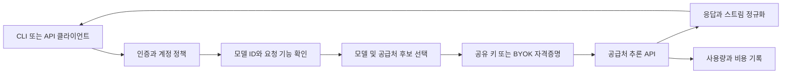

# OpenRouter 공개 구조와 Freeway 비교

## 분석 범위

이 분석은 공식 API, 공식 문서, 설치된 Ori CLI, 이번 세션의 실제 호출을 기준으로 한다. OpenRouter 비공개 서버 코드나 내부 데이터베이스 구조를 복원한 것이 아니다. 아래 계층도는 공개 동작을 이해하기 위한 개념 구조다.

## 이번 제품에서 말하는 한계

핵심 구조 차이는 요청을 받아 전달하는 프로그램의 위치다. OpenRouter의 통합 API는 운영 서버에서 모델 API에 요청하고, Freeway는 사용자 PC의 프로그램에서 로컬 모델 서버·공식 CLI·외부 API로 요청을 보낸다. 일반 OpenRouter API를 사용자 PC의 localhost나 CLI 실행기로 취급하지 않는다.

OpenRouter는 기업용 Private Endpoints에서 자체 HTTPS 모델 엔드포인트와 private provider를 지원한다. 따라서 자체 서버나 외부 모델 연결이 모두 불가능하다는 설명은 부정확하다. 이 기능도 OpenRouter API를 통해 서버에서 요청을 전달하는 구조이며, 사용자 PC에서 프로그램을 실행하는 Freeway의 구조와 구분한다. [Private Endpoints](https://openrouter.ai/docs/guides/routing/private-endpoints)

OpenRouter의 자동 대체·공급처 우선순위·BYOK 키 전환은 기존 기능이다. 키·예산·무료 모델 한도 조회도 제공한다. 이 기능의 부재를 Freeway의 개발 이유로 삼지 않는다. [공급처 선택](https://openrouter.ai/docs/guides/routing/provider-selection), [BYOK](https://openrouter.ai/docs/guides/overview/auth/byok), [한도 조회](https://openrouter.ai/docs/api_reference/limits)

우리에게 남는 문제는 외부 서비스 전용 무료 권한과 그 인증·한도·사용 흐름의 분산이다. Cline은 무료 사용을 IDE·CLI로 제한하고, OpenCode도 무료 계층 채팅 모델에 OpenCode가 필요하다고 안내한다. 해당 권한을 공식 인터페이스로 연결할 수 있는지 별도로 입증해야 한다. Freeway의 해결 범위와 역할은 [제품 공백과 책임 계약](17-product-gap-and-ownership.md)에 정리한다. [Cline 무료 모델](https://docs.cline.bot/getting-started/free-models), [OpenCode 모델](https://opencode.ai/docs/console/models/)

## 모델 카탈로그와 공급처 카탈로그

`GET /api/v1/models`는 공개 모델 ID, 가격, 지원 파라미터, 컨텍스트 등의 선택 근거를 제공한다. `GET /api/v1/providers`는 공급처 목록을 제공한다. 특정 모델의 `/endpoints`는 그 모델을 제공하는 공급처 경로를 조사할 때 유용하다.

이번 조회에서는 OpenRouter에 DeepSeek 유료 모델이 있었지만, `deepseek/*` 중 입력·출력 단가가 모두 0인 무료 모델은 없었다. 이 결과는 OpenRouter의 해당 시점 카탈로그에 대한 관측이며, DeepSeek를 무료로 제공하는 다른 서비스의 존재를 부정하지 않는다. [모델 API](https://openrouter.ai/api/v1/models)

Freeway도 모델과 경로를 분리해야 한다. 공급처가 표시하는 이름만으로 모델을 합치면 날짜가 다른 버전, Flash와 Pro, distillation, 다른 컨텍스트 제한을 섞을 수 있다. 카탈로그 조회 성공은 현재 계정으로 추론이 가능하다는 뜻도 아니다.

## 모델 전환과 공급처 전환

모델 전환은 모델 A가 요청을 처리하지 못할 때 모델 B를 시도하는 동작이다. OpenRouter는 `models` 목록을 통해 이를 지원한다. 공급처 전환은 같은 모델을 호스팅하는 여러 제공 경로 사이에서 선택하는 동작이다. `provider.order`, `provider.only`, `allow_fallbacks` 등은 이 선택 범위를 조정한다. [모델 전환](https://openrouter.ai/docs/guides/routing/model-fallbacks), [공급처 선택](https://openrouter.ai/docs/guides/routing/provider-selection)

이번 실제 시험은 다음 두 요청을 비교했다.

1. Gemma 무료 모델을 지정하면서 공급처를 Particle AI로 제한했다. 해당 공급처가 그 Gemma 경로를 제공하지 않아 HTTP 404를 받았다.
2. 같은 공급처 제한을 유지하면서 모델 목록에 Particle의 무료 모델을 뒤에 추가했다. 요청은 Particle 모델로 성공했고, 응답의 비용은 0이었다.

따라서 경로가 없는 첫 모델에서 다음 모델로 넘어가는 동작은 직접 확인했다. 잘못된 가상 모델 ID를 첫 항목으로 넣은 시험은 400으로 끝났으므로, 잘못된 ID도 항상 자동으로 건너뛴다고 설명하면 안 된다. 추가 실증에서는 Particle 무료 모델 단독 요청이 HTTP 429를 반환했고, Particle·Cohere 무료 모델을 순서대로 지정한 별도 요청은 Cohere로 성공했다. 성공 응답 비용은 0 USD였다. [실제 호출 결과](19-live-validation.md)

## 무료 모델 자동 선택

`openrouter/free`는 요청 기능에 맞는 무료 모델 중 하나를 자동 선택한다. 공식 설명은 기능 필터링 후 무작위 선택이며, 사용자가 원하는 특정 모델에 대한 품질 순위나 개인 무료 한도 최적화를 보장하지 않는다. [무료 라우터](https://openrouter.ai/docs/guides/routing/routers/free-router)

Freeway가 이를 다시 구현할 이유는 단순한 자동 선택이 아니라 사용자 지정 모델 선호, 외부 서비스의 무료 경로, 계정별 상태, 선택 이유를 포함할 때 생긴다. 무작위 선택이 충분하면 기존 라우터를 경로 하나로 사용하는 편이 단순하다.

## BYOK의 범위

BYOK는 사용자의 공급처 키를 등록하여 OpenRouter의 지원 경로를 자신의 계정 권한으로 호출하는 기능이다. 동일 공급처의 여러 키에 순서를 지정하고, 공유 용량을 사용할지 제어할 수 있다. 따라서 업체 키와 우선순위를 묶는 기능 자체도 이미 존재한다.

중요한 경계는 인증과 접속 대상의 구분이다. 공식 문서는 BYOK가 자격증명을 바꾸지만 라우팅 가능한 엔드포인트를 바꾸지는 않는다고 설명한다. OpenCode CLI나 Cline CLI의 실행 파일을 임의의 모델 공급처처럼 등록해 주는 기능으로 해석하면 안 된다. [BYOK](https://openrouter.ai/docs/guides/overview/auth/byok)

지원 공급처에 등록할 수 있는 API 키가 있다고 해도 그 키에 무료 권한이 있는지, 프로토타입 권한이 중계 경로에서 적용되는지, 유료 공유 용량으로 넘어가지 않는지는 별도로 확인해야 한다. BYOK 사용료와 무료 허용 범위도 변할 수 있으므로 코드에 영구적인 고정 요율로 박아 두지 않는다.

## 인증과 무료 한도

API 요청은 OpenRouter API 키를 사용한다. Ori는 브라우저 승인을 통해 자격증명을 저장하고 기존 에이전트를 OpenRouter에 연결한다. 이 제품군과 API 라우팅 서비스는 구분해야 한다.

현재 계정 조회에서는 무료 모델 일일 상한이 50으로 반환됐다. 공식 문서에는 기본 무료 한도와 크레딧 구매에 따른 상향 한도가 구분되어 있으며, 분당 제한도 있다. API 키를 여러 개 만들면 무료 사용량도 키마다 새로 생긴다고 가정하면 안 된다. 공급처 쪽 제한도 추가로 적용될 수 있다. [한도 문서](https://openrouter.ai/docs/api_reference/limits)

Freeway에는 계정 한도와 경로 상태가 별도 개념이어야 한다. 모델 이름을 바꾸는 것만으로 계정 전체 무료 한도가 복구되는 것은 아니다. BYOK 요청 등 다른 한도 정책이 적용되는 경우도 있으므로 모든 요청을 하나의 단순 일일 카운터로 설명하지 않는다.

## API 호환성의 의미

OpenRouter는 여러 모델의 요청·응답 차이를 호환 API로 다룬다. 그러나 호환이라는 말이 모든 모델에서 모든 옵션이 동일하게 동작한다는 뜻은 아니다. 도구 호출, 이미지, 추론 설정, 구조화 출력, 최대 출력 길이 등은 모델과 경로별로 다르다.

Freeway의 호환 API도 지원 범위를 문서로 고정해야 한다. 처음부터 Chat Completions, Responses, Anthropic Messages를 모두 완전하게 구현하는 대신 필요한 계약부터 검증한다. 지원하지 않는 파라미터를 몰래 버리는 것보다 명시적으로 거절하거나 변환 규칙을 공개하는 편이 안전하다.

## 스트리밍과 장애 경계

응답을 보내기 전 실패하면 다른 경로를 시도할 수 있다. 스트리밍 도중 오류는 이미 전송한 응답에 오류 이벤트가 추가되는 형태가 될 수 있다. 이미 나온 텍스트와 도구 인자를 다른 모델의 결과로 자동 교체하는 동작은 별도 문제다. [한도와 스트림 오류](https://openrouter.ai/docs/api_reference/limits)

Freeway는 초기 버전에서 클라이언트에 첫 응답 이벤트를 보낸 뒤 경로를 바꾸지 않는다. 특히 도구 호출 인자가 일부 전달된 상태에서는 모델 전환으로 부작용이나 잘못된 명령이 발생할 수 있다. 재생성은 새 요청으로 취급하고 사용자에게 전환 사실을 보여 준다.

## 비용 통제

OpenRouter의 가격은 최종 사용 모델과 기능에 따라 달라진다. 무료 모델을 첫 항목으로 지정해도 대체 목록에 유료 모델이 있으면 유료 요청이 될 수 있다. 공급처 최대 가격 제한은 후보를 제한하는 데 사용할 수 있다. 플러그인과 별도 도구·보조 호출의 비용은 별도로 확인해야 한다. [모델 전환 가격](https://openrouter.ai/docs/guides/routing/model-fallbacks), [최대 가격 필터](https://openrouter.ai/docs/guides/routing/provider-selection)

이번 Ori 실행은 이 차이를 실제로 보여 줬다.

| 호출 | 사용 모델 | 확인된 비용 |
| --- | --- | ---: |
| 답변 생성 | `nvidia/nemotron-3.5-lightning:free` | 0 USD |
| 별도 판단 요청 | `typesafe/jev-1.14-20261014` | 0.000057036 USD |
| 직접 API로 무료 라우터 호출 | `particle-ai/particle-1:free` | 0 USD |

보조 요청 금액은 사용량과 generation 조회 양쪽에서 확인했다. Jev 호출이 어떤 내부 판단을 수행했는지까지 특정하지는 않았다. 비용이 0이 아니었다는 결과와 그 내부 용도를 추정하는 일은 구분한다.

## Freeway에 재사용할 부분과 직접 만들 부분

| 기능 | 기존 기능을 활용하는 범위 | Freeway에서 추가할 가치 |
| --- | --- | --- |
| 모델 목록 | OpenRouter 카탈로그를 공급처 하나로 읽는다 | 다른 서비스의 무료 권한과 경로도 함께 등록한다 |
| 모델 대체 | OpenRouter 경로 내부에서 활용할 수 있다 | 외부 경로와 정책을 포함한 선택을 한다 |
| BYOK | 지원 공급처의 키 연결에 활용한다 | 지원되지 않는 공식 CLI 경로를 별도로 다룬다 |
| 사용량 | 공급처가 반환한 사용량과 한도를 읽는다 | 실제 값과 로컬 추정치를 구분해 통합한다 |
| 비용 | 요청별 비용과 가격 제한을 활용한다 | 보조 요청까지 포함한 무료 정책을 검증한다 |
| CLI | Ori·OpenCode·Cline을 사용 도구로 유지할 수 있다 | 연결과 선택 경험을 단순화한다 |

## 비교에서 피할 오류

OpenRouter에 원하는 무료 경로가 없다는 결과는 제품 공백의 증거가 될 수 있다. 반면 UI가 복잡해 보인다는 인상만으로 독립 라우터 전체를 정당화하지 않는다. 무료 공급처를 찾았다는 사실만으로 그 공급처의 CLI를 일반 추론 API로 재노출할 수 있다고 가정하지 않는다. 제품 경계는 [API와 어댑터 계약](08-api-and-adapters.md)에서 명시한다.
