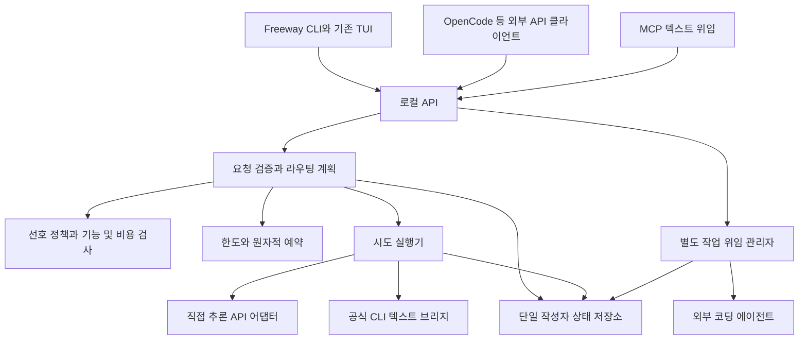
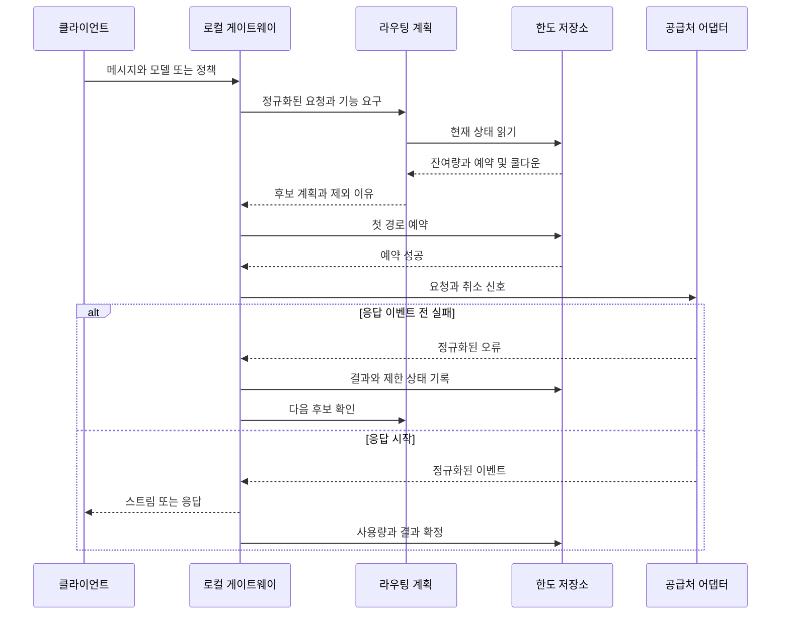

# Freeway 시스템 구조와 실행 흐름

## 기본 구조 제안

하나의 로컬 게이트웨이가 자격증명 참조, 카탈로그, 정책, 한도 예약, 실행 기록을 관리한다. CLI·TUI·브라우저 화면은 같은 코어의 클라이언트로 둔다. 공급처마다 별도 서버를 운영하는 구조나 클라우드 계정 시스템은 초기 필수 조건으로 만들지 않는다.

이 게이트웨이는 사용자 PC에 설치된 Freeway 프로그램이다. 같은 PC에서 실행 중인 모델 서버와 공식 CLI에 연결하고 외부 모델 API도 호출하는 구조를 목표로 한다. 로컬 모델 서버도 요청·이벤트·취소·기능 계약을 지키는 어댑터로 연결한다. 로컬 CLI를 실행해도 모델 추론은 외부 서버에서 이뤄질 수 있으므로 실행 위치와 추론 위치를 별도로 기록한다.

## 계층별 책임

| 계층 | 책임 | 맡기지 않을 책임 |
| --- | --- | --- |
| 사용 화면 | 연결 흐름, 모델 선택, 상태 설명 | 공급처별 재시도 판단 |
| 로컬 API | 인증, 입력 계약, 스트림 전송, 취소 | 모델 우선순위 계산의 중복 구현 |
| 라우팅 계획 | 기능·비용·권한 필터와 후보 정렬 | 실제 외부 요청 |
| 실행기 | 예약, 시도, 오류 분류, 결과 기록 | 사용자에게 숨긴 정책 변경 |
| 어댑터 | 공급처 프로토콜, 인증 전달, 정규화 | 다른 공급처를 자체 선택 |
| 상태 저장소 | 카탈로그, 예약, 사용량, 설정 | 프롬프트를 기본 수집하는 분석 시스템 |
| 작업 관리자 | CLI 에이전트 실행과 권한·작업 상태 | 일반 추론 API를 가장하는 도구 실행 |

어댑터가 공급처별 fallback을 내부적으로 수행하는 서비스에 연결될 수는 있다. 이 경우 Freeway는 내부 전환을 통제한다고 주장하지 않고, 공급처가 반환한 실제 모델과 비용을 관측한다. 중첩 fallback으로 시도 수와 시간이 무한히 늘어나지 않도록 서비스별 한도를 명시한다.

## 세 가지 실행 계약

### 직접 추론 API

메시지와 선택적 도구 정의를 받아 텍스트 또는 도구 호출을 반환한다. 도구 실행은 호출자가 담당한다. Freeway는 경로별 기능을 확인한 후 호환 API에 노출한다.

### CLI 텍스트 브리지

공식 CLI나 서버에 메시지를 전달하고 텍스트를 추출한다. 모델 답변을 얻을 수 있어도 임의의 도구 호출 객체를 손실 없이 전달할 수 있다는 뜻은 아니다. OpenCode의 현재 Freeway 브리지는 도구를 비활성화하고 텍스트를 추출하므로 우선 이 계약에 해당한다.

### 에이전트 작업 위임

공식 코딩 에이전트가 자신의 작업 상태와 도구를 관리한다. 작업 디렉터리, 실행 허용 범위, 결과, 파일 변경 여부와 취소가 계약에 포함된다. 초기 기본은 읽기 전용 검토 또는 독립 텍스트 작업으로 제한한다. 파일 변경 작업을 허용하는 시점은 별도 기능 결정이다.

## 추론 요청의 흐름

## 데이터 모델

| 개체 | 주요 필드 | 불변 조건 |
| --- | --- | --- |
| Provider | ID, 종류, 공식 URL, 인증 방식 | 특정 계정의 무료 권한과 혼합하지 않는다 |
| AccountConnection | ID, provider ID, credentialRef, 권한 상태 | 비밀 값은 노출 API에 포함하지 않는다 |
| ModelIdentity | 제조사, 모델, 버전, 변형 | 명확하지 않은 별칭은 자동 병합하지 않는다 |
| Route | ID, 모델, 연결, 인터페이스, 기능, 무료 근거 | 실제 실행할 경로 하나를 나타낸다 |
| Entitlement | 무료 유형, 기간, 비용 조건, 출처 | 계정·모델 범위를 명확히 가진다 |
| QuotaBucket | scope key, 단위, 창, 상한, 실제·추정 사용량 | 같은 상위 한도를 중복 합산하지 않는다 |
| Reservation | 요청, 경로, 예상량, 상태, 만료 | 예약과 사용량 확정을 중복 적용하지 않는다 |
| Attempt | 요청, 순서, 경로, 시각, 결과, 오류 | 하나의 외부 시도를 한 번 기록한다 |
| RequestRecord | ID, 정책, 결과, 비용 확인 수준 | 기본적으로 메시지 원문을 포함하지 않는다 |
| Conversation | 로컬 대화 ID, 메시지, 모델 선택 | 일반 API 요청 저장과 분리한다 |

## 저장소 선택

현재 JSON 저장소를 즉시 모두 교체할 필요는 없다. 초기 단계에서는 게이트웨이 한 프로세스만 상태를 쓰고, 예약과 기록을 한 직렬화 경로로 처리한다. CLI는 직접 파일을 수정하지 않는다. 원자적 파일 교체와 시작 시 복구 규칙을 검증한다.

단일 작성자는 단순한 실행 가정이 아니라 시작 절차로 강제한다. 데이터 폴더를 정규화한 경로를 잠금 단위로 사용하고, Store 생성·키 생성·스냅샷 갱신보다 먼저 배타 잠금을 획득한다. 같은 폴더를 다른 포트로 실행해도 두 번째 작성자를 허용하지 않는다.

잠금 소유자는 프로세스 식별 정보와 접속 가능한 서버 주소를 게시한다. 후발 CLI는 공유 상태를 수정하지 않고 기존 서버 연결을 재시도한다. 프로세스가 죽었다는 근거와 잠금 소유권을 확인한 경우에만 stale 잠금을 회수한다. 포트가 닫혔다는 이유만으로 잠금을 삭제하지 않는다. 잠금 파일은 동일한 OS 잠금 또는 원자적 획득 규칙으로 관리한다.

서버 시작에 실패하면 자신의 잠금만 해제한다. 두 CLI의 동시 첫 실행, 같은 폴더·다른 포트, 심볼릭 링크로 같은 폴더를 가리키는 경우, 크래시 후 재시작을 별도 시험한다. 현재 `Client.connect()`의 서버 spawn과 `createGateway()`의 Store 초기화 순서는 이 계약에 맞게 수정할 대상이다.

독립 프로세스가 동시에 상태를 쓰거나 예약 규모가 파일 저장에 부담을 주면 SQLite를 사용한다. SQLite로 전환할 때는 예약·확정 트랜잭션, 고유 attempt 키, 스키마 버전, JSON import와 백업·복구를 함께 설계한다. 데이터베이스 도입만으로 공급처의 실제 한도를 알 수 있게 되는 것은 아니다.

## 자격증명 경계

각 어댑터는 필요한 공급처 자격증명만 전달받는다. 자식 CLI에 부모 프로세스의 모든 API 키를 그대로 넘기지 않는다. 공식 CLI가 이미 안전하게 로그인 상태를 관리한다면 그 저장소를 우회해 키를 추출하는 방식을 제품 인터페이스로 삼지 않는다.

현재 Freeway의 암호화는 키와 암호문이 같은 OS 계정 경계 안에 있다. 디스크 파일을 함께 복사할 수 있는 공격자까지 막는 OS 키 저장소라고 설명하지 않는다. 초기 보호 모델과 나중에 추가할 OS 키 저장소 지원을 분리한다.

## 대화 상태와 도구 상태

호환 API의 대화는 기본적으로 호출자가 메시지 전체를 보낸다. Freeway는 공급처의 세션 ID를 대화의 유일한 원본으로 삼지 않는다. CLI 이력은 별도 저장하며 경로가 바뀌면 전달 가능한 메시지를 재구성한다.

외부 에이전트의 내부 계획, 도구 실행 결과, 파일 변경, 압축된 문맥은 일반 채팅 메시지와 같지 않다. Cline의 진행 중 작업을 OpenCode로 이어받는 기능은 초기 버전에 포함하지 않는다. 새 작업으로 위임할 때는 필요한 문맥과 이미 수행한 작업을 명시한다.

## 장애 격리

직접 API의 네트워크 실패는 해당 시도에 영향을 준다. 특정 모델의 429는 가능하면 모델 또는 계정 한도 범위로 격리한다. 인증 만료는 해당 연결 전체를 재인증 상태로 바꾼다. CLI 크래시는 브리지 상태로 기록하고 다른 공급처의 프로세스까지 종료하지 않는다.

취소 시 자신이 생성한 자식 프로세스만 정리한다. 기존 사용자가 실행한 OpenCode나 Cline 프로세스를 포괄적으로 종료하지 않는다. Windows와 Unix의 프로세스 트리 정리는 별도 시험이 필요하다.

## 확장 경계

처음부터 플러그인 마켓이나 원격 워커 시스템을 만들지 않는다. 공급처 차이는 명시적인 어댑터로 수용한다. 자주 변하는 모델 목록과 한도 근거는 데이터로 분리하되, 실행 가능한 외부 코드를 자동 다운로드하는 공급처 정의는 허용하지 않는다.
