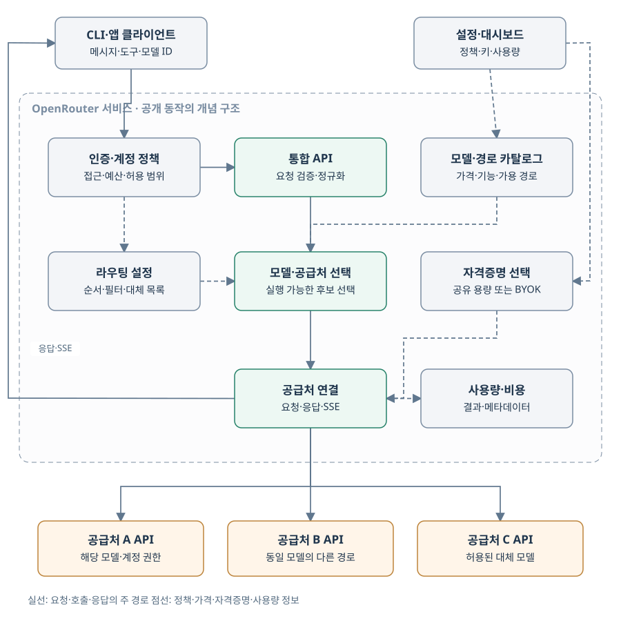
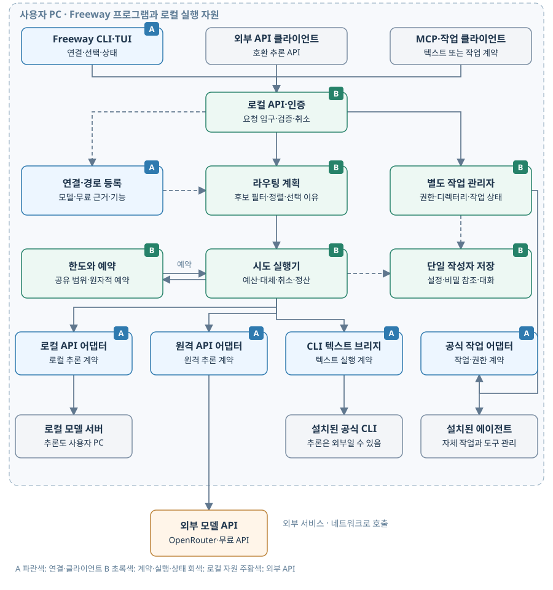
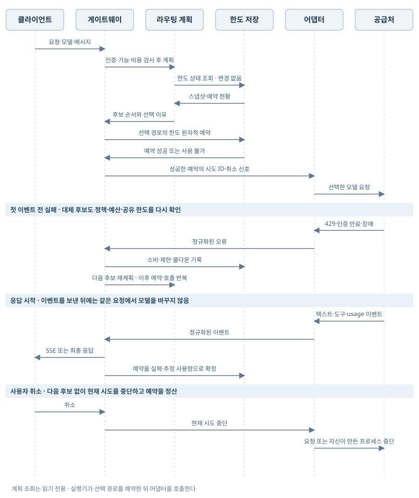
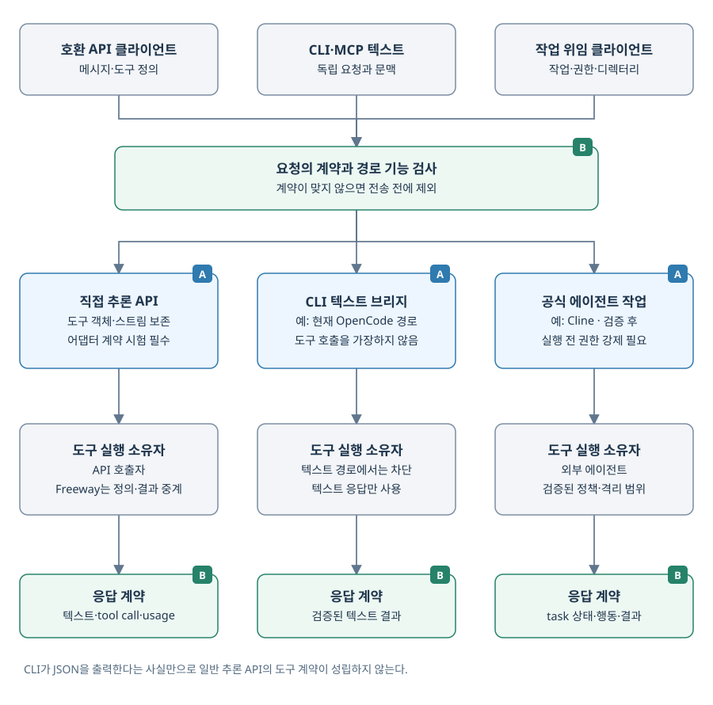
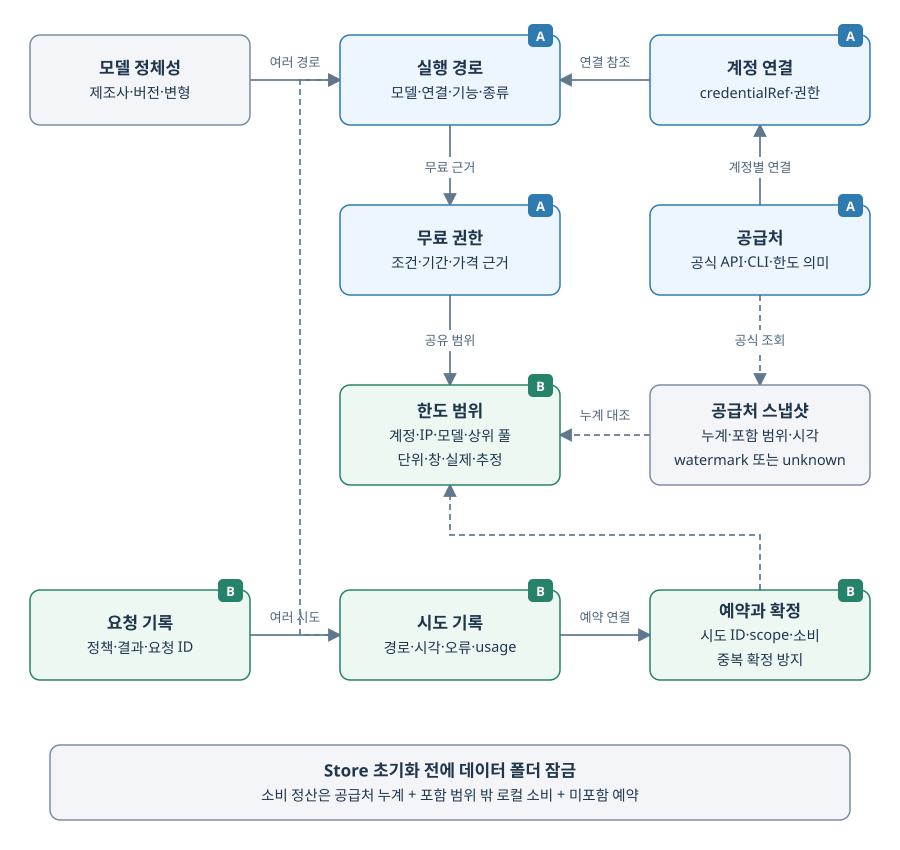
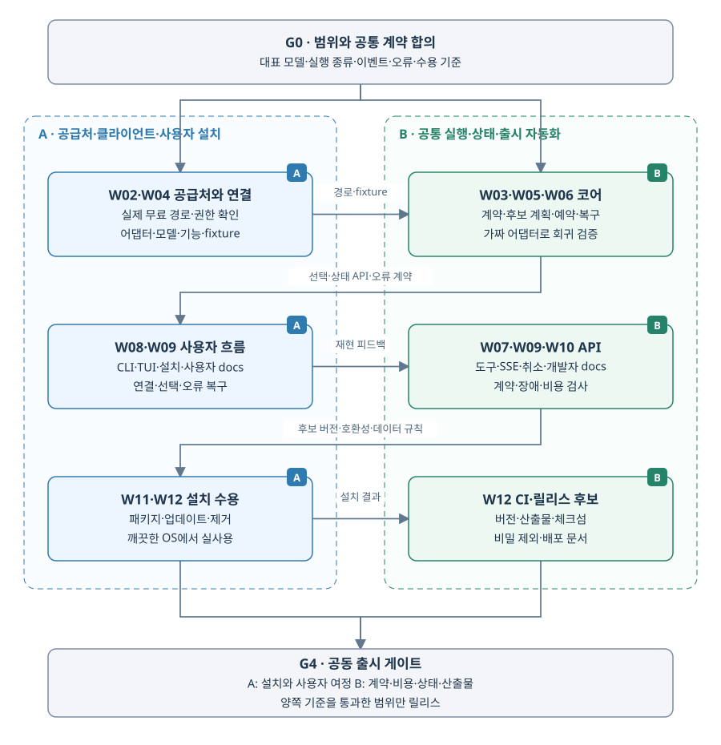
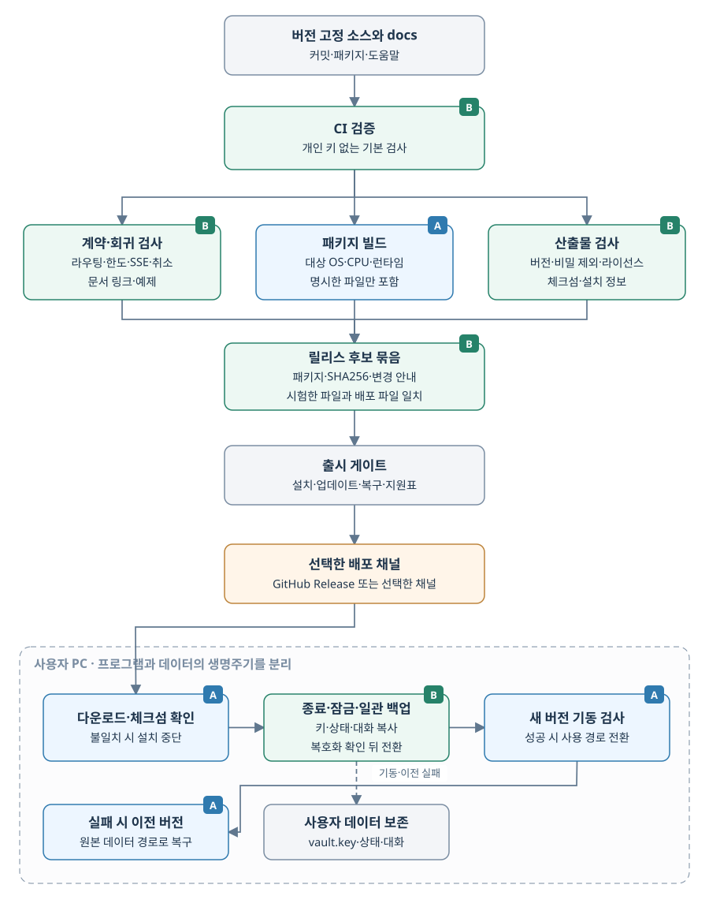

# Freeway 아키텍처와 실행 계획

이 문서는 핵심 기획 뒤에 읽는 아키텍처 상세다. 아키텍처는 실제 그림으로 제시하고, 개별 작업의 범위와 완료 조건은 [계층별 작업 분해](16-work-breakdown.md)에 연결한다. 최신 핵심은 18번, 실제 호출 결과는 19번 문서를 따른다.

먼저 [OpenRouter에서 남는 문제와 책임 계약](17-product-gap-and-ownership.md)을 읽는다. OpenRouter의 자동 전환·우선순위·BYOK·한도 조회는 기존 기능이다. Freeway가 해소하려는 것은 외부 서비스에 흩어진 무료 권한(P1), 사용 가능 상태(P2), 반복되는 연결·선택 작업(P3)이다. 대표 외부 경로를 공식 방식으로 연결할 수 있는지 입증한 다음 아래 구조의 필요한 부분을 구현한다.

## 제품의 출발점과 현재 판정

Freeway의 목표는 여러 서비스가 개인에게 제공하는 무료 모델 접근 경로를 모으고, 모델·기능·한도·인증 상태에 맞는 경로를 선택하는 로컬 도구다. OpenRouter는 비교 대상이면서 사용할 수 있는 공급 경로 하나다.

| 실제 시험 | 결과 | 제품에 반영할 것 |
| --- | --- | --- |
| OpenRouter 무료 응답·대체 | 무료 응답 성공, 429 대조군 뒤 무료 대체 요청 성공, 비용 0 USD | 기존 자동 전환을 차별점으로 설명하지 않는다 |
| OpenRouter DeepSeek 목록 | 20개 중 입력·출력 단가가 모두 0인 모델 0개 | 원하는 모델의 무료 경로는 서비스별로 비교한다 |
| OpenCode 공식 서버 | 무료 DeepSeek 조회 후 실제 요청에서 무료 할당 초과 | 할당 소진으로 분류하고 사용할 수 있는 다른 경로를 고른다 |
| Cline 공식 CLI | 재로그인 후 model not found, CLI는 프로모션 종료 안내 | 현재 호출이 거절된 모델을 활성 경로에서 제외한다 |

실제 요청·응답·비용은 [실증 결과](19-live-validation.md)에 있다. 외부 경로 연결과 가용 상태 관리가 Freeway의 추가 범위이며, 세부 인터페이스는 아래 실행 계약을 따른다.

# OpenRouter 아키텍처와 기능

## 시스템 구조

그림은 공식 API와 공개 동작을 설명한 개념 구조다. OpenRouter 비공개 서버의 실제 모듈 배치나 내부 데이터베이스를 복원한 것은 아니다. 실선은 요청과 응답, 점선은 설정·가격·자격증명·사용량 같은 제어 정보를 나타낸다.

## 구성요소의 역할

| 구성요소 | 입력 | 실제로 하는 일 | 경계 |
| --- | --- | --- | --- |
| 통합 API | 메시지·모델 ID·도구·출력 옵션 | 공통 API 계약으로 요청을 받는다 | 모델마다 지원 기능이 다르다 |
| 인증·계정 정책 | API 키·계정 설정 | 접근 권한·예산·허용 범위를 확인한다 | 무료 계정의 전체 한도는 모델 변경만으로 늘지 않는다 |
| 모델·경로 카탈로그 | 공급처별 모델·가격·기능 | 선택할 모델과 제공 경로를 알려 준다 | 목록에 있다고 현재 계정의 무료 권한이 확인된 것은 아니다 |
| 라우팅 | 모델 목록·공급처 순서·필터 | 실행 후보를 고르고 실패 전 다음 후보를 시도한다 | 잘못된 모델 ID 같은 입력 오류가 항상 대체되는 것은 아니다 |
| 자격증명 선택 | 공유 용량 또는 BYOK 키 | 지원 공급처의 호출 권한을 결정한다 | 임의 외부 CLI를 공급처로 등록하는 기능이 아니다 |
| 공급처 연결 | 정규화된 요청·선택 경로 | 실제 모델 API에 요청하고 결과를 받는다 | 공급처 자체 상태와 한도에 영향을 받는다 |
| 응답·사용량 | 텍스트·도구·스트림·usage | 결과와 비용을 클라이언트에 반환한다 | 별도 보조 호출의 비용은 따로 확인해야 한다 |

## 기능별 장점과 이번 목표에서의 한계

| 기능 | 장점 | 한계 또는 추가 확인 |
| --- | --- | --- |
| 통합 API | 여러 모델을 같은 호출 방식으로 사용한다 | 모든 모델의 모든 옵션이 같지는 않다 |
| 모델 대체 | 주 모델이 처리하지 못할 때 다른 모델로 넘긴다 | 모델 변경에 따른 품질과 기능 차이를 관리해야 한다 |
| 공급처 순서 | 선호 공급처와 허용 범위를 설정한다 | 개인의 외부 무료 계정 잔여량을 모두 아는 것은 아니다 |
| 무료 라우터 | 무료 후보의 수동 선택을 줄인다 | 특정 DeepSeek·Muse 변형을 보장하지 않는다 |
| BYOK | 자신의 공급처 키와 키 우선순위를 연결한다 | 지원 엔드포인트와 무료 권한 적용 범위를 검증해야 한다 |
| Ori 연동 | 기존 코딩 CLI를 OpenRouter에 연결한다 | 주 모델 선택만으로 모든 보조 요청 비용을 제한하지 못한 사례가 있다 |

## OpenRouter로 끝낼 조건과 Freeway를 만들 조건

원하는 모델·무료 권한·기능·한도가 OpenRouter와 기존 CLI 설정으로 충족되면 자체 코어를 줄인다. 반대로 OpenCode·Cline 같은 도구 전용 무료 권한, OpenRouter 밖의 무료 API, 공급처별 한도 표시·선택 경험이 실제로 필요하면 Freeway의 범위가 생긴다.

OpenRouter의 자동 대체와 BYOK는 재사용할 기능이다. Freeway의 차별점은 무료 모델 목록을 다시 나열하는 데 있지 않고, 서비스마다 다른 무료 권한과 실행 계약을 사용자 관점에서 관리하는 데 있다.

# Freeway 아키텍처와 기능

## 로컬 제품의 전체 구조

하나의 로컬 게이트웨이가 상태를 소유한다. CLI·TUI·외부 API 클라이언트·MCP는 동일한 코어를 사용한다. 공급처 어댑터는 호출 방법을 책임지고, 라우팅 코어는 어떤 경로를 선택할지 책임진다. A와 B는 실명 배정이 아닌 기능별 책임 제안이다.

## 모듈별로 구현할 기능

| 모듈 | 구현할 내용 | 기존 코드의 출발점 | 주 담당 |
| --- | --- | --- | --- |
| 공급처 등록 | 모델 ID·버전·무료 근거·인증 방식·기능·기간 | catalog.mjs | A |
| 연결 관리 | 공식 로그인·키 입력·만료·재연결 | 기존 공급처 설정·공식 CLI | A |
| 어댑터 | 모델 조회·호출·정규화·취소·usage·오류 | adapters.mjs, opencode.mjs | A |
| 라우팅 계획 | 모델 고정·Auto·기능·비용·우선순위 검사 | engine.mjs | B |
| 한도 예약 | 한도 범위·실제값·추정·동시 요청·쿨다운 | store.mjs | B |
| 실행기 | 시도 예산·시간 제한·실패 전 대체·정산 | engine.mjs | B |
| 호환 API | 인증·옵션·도구·SSE·부분 실패·취소 | server.mjs | B |
| CLI·TUI | 연결·모델·경로·사용량·선택 이유·오류 복구 | cli.mjs, tui.mjs | A |
| 작업 위임 | 외부 작업·읽기 전용 강제·취소 | 현재 텍스트 MCP와 별도 계약 | B, 어댑터는 A |
| docs·출시 | 사용자 docs·설치·CI·릴리스·복구 | README·설치 스크립트 | 기능별 분담 |

## 먼저 출시할 범위

첫 범위는 대표 무료 경로 검증, 안전한 코어, 검증된 추론 API, 기존 CLI의 연결·상태 UX, 사용자 docs, 테스트 배포다. 30개 공급처 동시 구현, 공용 무료 서버, 진행 중 에이전트 상태 자동 이식, Go·Rust 전면 재작성은 초기 필수 조건이 아니다.

현재 OpenCode 브리지는 도구를 끄고 텍스트를 추출한다. 이 경로를 임의의 코딩용 도구 호출 API로 설명하지 않는다. 추론 API로 승격하려면 도구 ID·인자·이력·종료 상태가 보존되는지 시험해야 한다.

# 요청과 데이터가 움직이는 방식

## 정상 응답과 시작 전 대체

입력 오류와 사용자 취소는 대체 요청으로 숨기지 않는다. 한도 또는 경로 장애가 첫 응답 이벤트 전에 발생하면 정책이 허용한 다음 후보로 이동한다. 텍스트뿐 아니라 role·tool ID·도구 인자 조각을 하나라도 클라이언트에 보냈으면 같은 요청에서 모델을 바꾸지 않는다.

## 세 가지 실행 계약

| 계약 | 받는 것 | 반환하는 것 | 허용되지 않는 혼동 |
| --- | --- | --- | --- |
| 직접 추론 | 메시지·옵션·도구 정의 | 텍스트·도구 호출·usage | 서버가 호출자의 도구를 임의 실행 |
| CLI 텍스트 | 독립 텍스트 요청과 문맥 | 검증한 텍스트 결과 | 텍스트를 임의의 tool call 객체로 변환 |
| 에이전트 작업 | 작업·디렉터리·권한·기한 | 작업 상태·답변·행동·변경 결과 | 다른 에이전트의 내부 상태 자동 이식 가정 |

작업의 read-only는 실행 전 도구 정책·hook·격리로 강제한다. 강제할 수 없는 경로는 읽기 전용 후보에서 제외한다. 파일 변경을 사후에 알아내는 것만으로 보호를 완료했다고 하지 않는다.

## 데이터와 한도의 관계

모델과 경로는 다르다. 같은 모델의 경로가 여러 개여도 상위 계정·IP·모델 풀의 무료 할당을 공유할 수 있다. 한도는 그 범위를 기준으로 식별하고 예약·사용량을 한 번만 확정한다.

공급처 누계와 로컬 소비를 더할 때는 스냅샷에 어떤 로컬 이벤트가 포함됐는지 확인한다. 포함 범위를 모르면 정확한 잔여량을 주장하지 않고 보수적 추정으로 표시한다. local_budget_guard와 공급처의 확정 quota_exhausted는 다른 오류다.

단일 작성자는 Store 초기화 전에 데이터 폴더 잠금을 잡아 보장한다. 두 CLI가 동시에 시작하거나 다른 포트로 같은 데이터 폴더를 열어도 작성자는 하나여야 한다.

# 분업과 작업 인계

## A와 B가 만나는 지점

## 역할을 실제 작업으로 설명하기

**A는 공급처와 사용자가 접하는 면을 맡는다.** 어떤 무료 모델이 어떤 계정·인터페이스에서 제공되는지 확인하고, 공식 로그인과 모델 조회·호출을 어댑터로 만든다. CLI·TUI에서 연결·선택·한도·오류가 읽히게 하고, 사용자가 설치·연결할 문서와 설치 패키지를 검증한다. 공급처 내부 오류를 정규화해 B에게 전달하지만 다음 공급처를 직접 선택하지 않는다.

**B는 공통 실행과 상태를 맡는다.** A가 제공한 경로 정보로 후보를 검사·정렬하고, 한도를 예약한 뒤 정해진 예산 안에서 실행한다. API 계약·SSE·도구 호출·취소·쿨다운·상태 복구를 보장한다. CI와 릴리스 산출물의 버전·체크섬·비밀 제외를 자동 검증한다. 공급처별 UI나 HTTP 특례를 라우팅 코어에 흩어 넣지 않는다.

**공통 계약은 함께 검토하되 각 태스크의 작성 책임자는 한 명이다.** A가 제출할 것은 단순한 업체 이름 목록이 아니라 무료 근거·모델 정체성·기능·한도 범위·정규화 이벤트·시험 fixture다. B가 제출할 것은 단순 서버 코드가 아니라 선택 이유·예약 상태·실패 전이·결과·추적 가능한 검증 결과다.

공급처 로그인·토큰 만료 감지는 A, 비밀의 공통 저장·로컬 API 인증은 B가 작성한다. 공급처 한도 의미와 조회는 A, 원자적 예약·차감·정산은 B가 작성한다. 패키징 명령·설치기·프로그램 버전 교체는 A, 데이터 이전·스키마 복구·CI 실행·체크섬·최종 릴리스는 B가 작성한다. 오류는 최초 실패한 계약의 담당자가 수정한다. 구체적인 인계 항목과 수락 조건은 17번 문서가 기준이다.

## 공동 결정과 단독 책임

| 항목 | 결정하는 사람 | 구현 책임 | 결정 시점 |
| --- | --- | --- | --- |
| 사용 환경·대표 모델·필수 기능 | A와 B 공동 | W01 산출물에 고정 | 공급처 구현 전 |
| 이벤트·오류·기능 계약 | B 초안, A 검토 | B | 어댑터 병렬 작업 전 |
| 실제 무료 조건 | A가 근거 제출 | A | 활성 경로 등록 전 |
| 모델 변경·한도·비용 정책 | B 규칙 제시, A 사용성 검토 | B | 코어 구현 전 |
| 사용자 docs·도움말 | A 초안, B 계약 대조 | A | 테스트 배포 전 |
| 릴리스 후보와 게시 | A 설치, B 게이트 확인 | B 산출물 정리 | 양쪽 게이트 통과 후 |

## 작업을 받는 단위

다음 작업 분해에서 대분류는 제품 영역, 중분류는 작업 묶음, 소분류는 실제 티켓이다. 소분류에는 담당, 선행 작업, 해야 할 일, 넘길 산출물, 완료 기준이 있다. “라우팅 담당”처럼 끝을 알 수 없는 업무 배정은 하지 않는다.

# docs와 배포 아키텍처

## 코드에서 사용자 설치까지

초기 배포는 로컬 CLI와 게이트웨이를 사용자 PC에 설치하는 일이다. 기존 Windows x64 설치 흐름을 먼저 검증하고 추가 OS·npm 배포는 선택 후 각각 시험한다. 현재 private: true인 패키지를 이미 npx로 공개 사용할 수 있는 것처럼 문서에 쓰지 않는다.

## docs에서 만들어야 할 것

| 독자 | 반드시 제공할 문서 | 주 작성 책임 |
| --- | --- | --- |
| 처음 쓰는 사용자 | README·설치·빠른 시작·첫 무료 요청 | A |
| 공급처를 연결하는 사용자 | 계정·로그인·키·무료 조건·모델·한도 | A |
| CLI 사용자 | 명령·플래그·JSON·종료 코드·오류 복구 | A |
| API를 연결하는 개발자 | 인증·모델·요청·응답·SSE·도구·오류 | B |
| 새 공급처를 추가하는 개발자 | 어댑터 계약·fixture·로컬 실행·검사 | B |
| 업데이트하는 사용자 | 변경점·지원 범위·데이터 이전·복구·제거 | B 초안, A 설치 확인 |

처음에는 Markdown으로 제공하고 구현과 같은 PR에서 갱신한다. 별도 문서 사이트는 독립적인 추가 작업이다. 내부 후보 30개와 실제 지원 공급처를 사용자 docs에서 구분한다.

## 출시를 끝냈다고 할 기준

빌드 파일 하나를 올렸다고 출시 완료가 아니다. 새 사용자가 문서대로 설치·연결·요청·실패 복구를 수행해야 한다. 버전·도움말·지원표가 일치하고, 배포 ZIP에 키·대화·로그가 없어야 하며, 업데이트가 기존 vault.key와 상태·대화를 보존해야 한다. 이전은 복호화 검증 뒤 전환하고 실패하면 원본 경로로 돌아간다.

# 구현 순서와 의사결정 지점

| 게이트 | 끝내야 할 작업 | 통과 증거 | 다음 단계 |
| --- | --- | --- | --- |
| G0 범위·계약 | W01과 W03의 모델·경로·이벤트 계약 | 범위표·계약 예시·가짜 어댑터 | 같은 계약으로 병렬 구현 |
| G1 무료 경로 | W02·W04의 로그인·호출·비용 | 공급처별 관측과 실제 입출력 | 불가능한 경로 제외 |
| G2 공통 실행 | W05·W06·W07의 코어·API | 실패·경쟁·취소·도구·비용 시험 | 실제 클라이언트 통합 |
| G3 사용자 제품 | W08·W09의 CLI·docs | 설치·연결·요청·오류 복구 | 테스트 배포 후보 |
| G4 테스트 배포 | W10·W11·W12의 품질·출시 | OS·업데이트·복구·체크섬 | 검증한 범위로 릴리스 |

검증되지 않은 무료 권한을 등록 모델 수로 대체하지 않는다. Go나 Rust를 선택하더라도 게이트와 계약 시험은 유지한다. 실제 태스크의 의존 관계와 산출물은 다음 [계층별 작업 분해](16-work-breakdown.md)에 이어진다.
