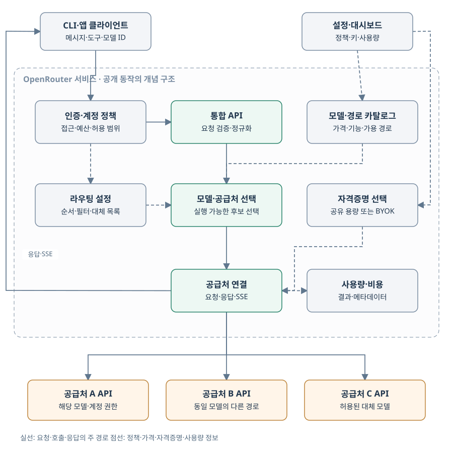
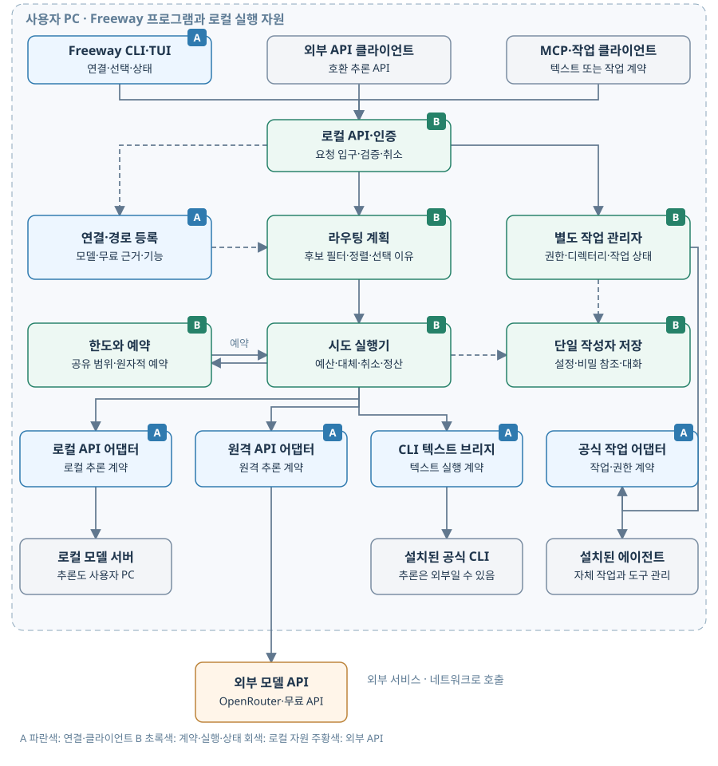

# 핵심 기획

**핵심 차이는 게이트웨이의 실행 위치다. OpenRouter는 운영 서버에서, Freeway는 사용자 PC에 설치된 프로그램에서 요청을 받아 전달한다.**

| 비교 | OpenRouter | Freeway 목표 구조 |
| --- | --- | --- |
| 요청을 받는 프로그램의 위치 | OpenRouter 서버 | 사용자 PC |
| 연결 방식 | 서버에서 모델 API 호출 | PC에서 로컬 모델 서버·공식 CLI·외부 API 연결 |

게이트웨이는 요청을 받는 공통 입구이고, 라우팅은 그 요청을 어느 경로로 보낼지 고르는 일이다.

## 1. 오픈라우터에서 안 되는 점

일반 OpenRouter API는 사용자 PC의 `localhost`나 설치된 CLI를 직접 실행하는 구조가 아니다. Freeway는 같은 PC에서 실행하므로 로컬 주소와 프로그램을 어댑터로 연결할 수 있다.

OpenRouter도 기업용 Private Endpoints로 자체 HTTPS 모델 서버 연결을 지원한다. 따라서 자체 모델 서버 연결이 전부 불가능하다는 뜻은 아니다. 그 경우에도 요청을 받아 전달하는 곳은 OpenRouter 서버다. [공식 문서](https://openrouter.ai/docs/guides/routing/private-endpoints)

**무료 사용과 자동 전환은 OpenRouter에서도 된다.** 실제 무료 응답과 429 대조군 뒤 무료 대체 요청이 성공했고 비용은 0원이었다. 해당 조회의 DeepSeek 20개 중 무료 모델은 0개였다. 상세 입출력은 [실증 결과](19-live-validation.md)에 둔다.

## 2. 우리가 가져갈 점

- **로컬 중심 연결:** 로컬 모델 서버, PC에 설치된 공식 CLI, 외부 무료 API를 하나의 입구로 연결한다.
- **사용 가능 상태 통합:** 로그인, 한도 소진, 프로모션 종료를 구분해 지금 쓸 수 있는 경로를 보여 준다.
- **선택과 복구 통합:** 선호 모델·공급처 순서에 따라 같은 CLI에서 요청하고, 막힌 경로는 제외한다.

OpenCode 실증에서는 무료 한도 초과, Cline의 해당 DeepSeek 실증에서는 `model not found`를 받았고 공식 CLI가 프로모션 종료 안내를 표시했다. Freeway가 이미 소진된 할당이나 종료된 프로모션을 되살리지는 않는다. 사용 가능한 다른 무료 경로를 찾는 것이 해결 범위다.

## 3. 우리 골인 — 최종 목표

**사용자 PC에서 로컬 모델 서버·공식 CLI·외부 무료 API를 하나의 CLI·API로 묶고, 사용 가능한 경로로 요청을 배분하는 것.**

사용자는 지원하는 모델 서버나 서비스를 연결한 뒤 원하는 모델 또는 무료 자동 선택을 고른다. 막히면 허용된 다른 경로로 전환하고, 사용할 경로가 없으면 멈춘다. 로컬 CLI 실행과 로컬 모델 추론은 구분한다. 모델 지원은 각 API·CLI 어댑터가 보장하는 범위다.

## 4. 오픈라우터 구조



클라이언트의 요청을 받고 모델·공급처·키를 선택해 모델 API를 호출한다. 무료 선택과 실패 시 대체를 이미 제공한다. 이 기능을 다시 만드는 것만으로 Freeway를 정당화하지 않는다.

## 5. 우리 구조



CLI·외부 클라이언트는 로컬 게이트웨이를 사용한다. A의 어댑터가 외부 API·공식 CLI와 연결하고, B의 코어가 기능·비용·상태를 보고 선택·예약·실행·정산한다. 텍스트 실행과 코딩 도구 호출은 각각의 계약을 지키는 경로로 제공한다.

# 6. 우리 폴더 구조

아래는 기존 Node POC를 기준으로 한 목표 구조다. 현재 파일을 전부 옮기는 것을 첫 작업으로 삼지 않고, 실제 변경하는 기능부터 책임에 맞춘다.

```text
freeway-cli/
  cli.mjs                     # A: 명령 진입점
  server.mjs                  # B: 로컬 게이트웨이 진입점
  src/
    contracts/                # B: 경로·기능·이벤트·오류 계약
    providers/                # A: 공급처·로그인·모델·어댑터
    core/                     # B: 선택·실행·전환·취소
    state/                    # B: 비밀 저장·한도·잠금·대화
    api/                      # B: HTTP·SSE·MCP
    cli/                      # A: 명령·게이트웨이 클라이언트
    tui/                      # A: 화면·선택·상태 표시
  tests/
    providers/                # A: 공급처 입출력·실제 호출
    core/                     # B: 정책·예약·실패·복구
    api/                      # B: 호환 계약·스트림·취소
    install/                  # A: 설치·업데이트·제거
  scripts/
    package/                  # A: 포함 파일·패키징 명령
    install/                  # A: 설치기·버전 교체
    migrate/                  # B: 데이터 이전·복호화·복구
    ci/                       # B: 검사·버전·체크섬·릴리스
  docs/
    user/                     # A: 설치·공급처·CLI·문제 해결
    api/                      # B: API 참고
    development/              # B: 어댑터 계약·검사 방법
    planning/                 # 기획·설계·실증 근거
```

## 7. 분업과 첫 결과물

| 담당 | 끝까지 책임지는 것 | 넘길 결과물 |
| --- | --- | --- |
| A — 외부 연결과 사용자 제품 | 공급처 조사·공식 로그인·어댑터·CLI·TUI·사용자 docs·패키징·설치 | 경로 정의·무료 조건·한도 의미·이벤트 fixture·사용 화면·설치 결과 |
| B — 공통 실행과 출시 | 계약·라우팅·한도 예약·API·상태·비밀 저장·데이터 이전·CI·릴리스 | 공통 계약·가짜 어댑터·실행/상태 API·선택 이유·회귀 검사·릴리스 후보 |

A는 “어떻게 연결하고 보여 주는가”, B는 “무엇을 선택해 어떻게 실행하고 기록하는가”를 맡는다. 공급처 호출·로그인·UI 오류는 A, 공통 계약·선택·예약·프로토콜 오류는 B가 수정한다. 패키징 명령은 A가 작성하고 CI는 B가 그 명령을 실행한다.

첫 결과물은 **외부 무료 경로가 포함된 두 독립 경로에서 동일한 텍스트 요청을 실행하고, 한도 오류 주입 시 다른 경로로 전환하는 CLI**다. 이어서 검증된 기능만 API에 노출한다. 상세 책임·인계 조건, 72개 태스크, 요청·한도·배포 설계는 다음 상세 문서에 둔다.
