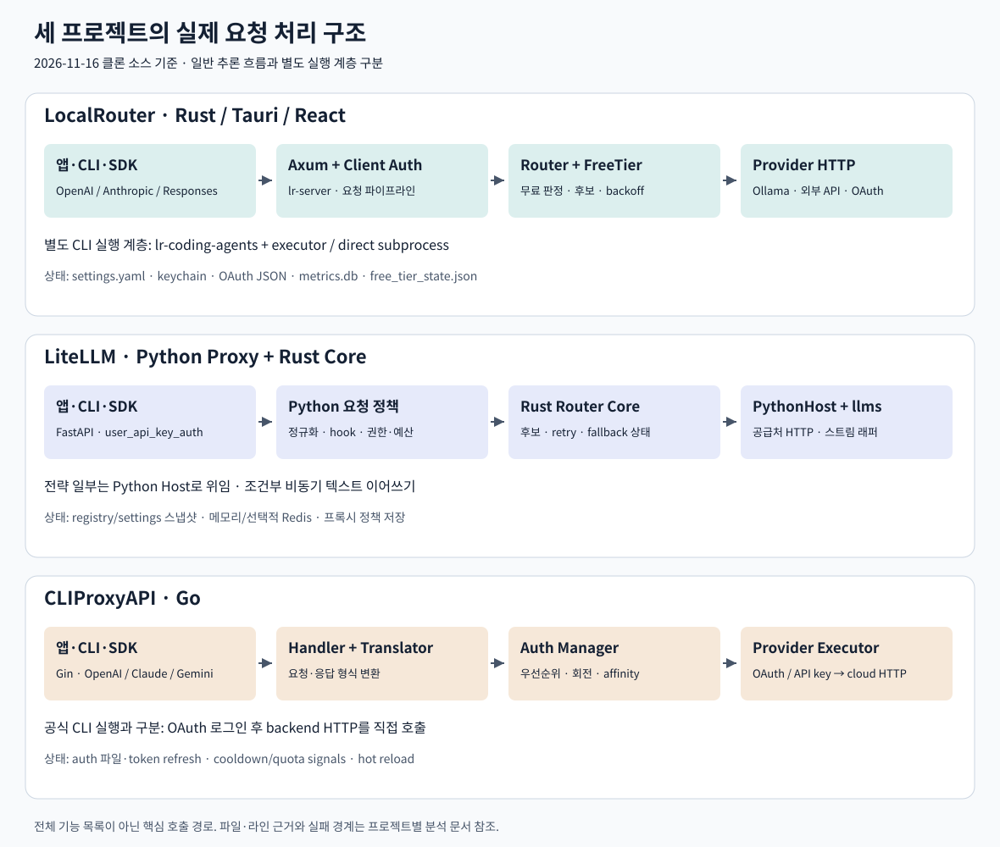

# 프리웨이 유사 프로젝트 소스 분석

## 먼저 읽을 결론

**로컬 게이트웨이와 무료 경로 자동 전환은 이미 있는 기능이다. 특히 LocalRouter가 프리웨이 구상과 크게 겹친다.** ‘OpenRouter는 서버, 프리웨이는 개인 PC’라는 차이는 OpenRouter와의 비교에는 의미가 있지만, 기존 로컬 게이트웨이 전체를 상대로 한 차별점은 아니다.

세 프로젝트를 실제로 클론하고 요청 진입, 인증, 후보 선택, 호출, 실패 전환, 스트리밍, 사용량과 저장 경계를 추적했다. 아래 내용은 2026-11-16에 고정한 커밋 기준이며, 운영 서비스의 현재 계정 권한을 시험한 결과와 구분한다.

| 프로젝트 | 실제 중심 구조 | 프리웨이와 겹치는 부분 | 읽을 문서 |
| --- | --- | --- | --- |
| LocalRouter | Rust/Axum 게이트웨이, Tauri/React 앱, 별도 코딩 에이전트 실행 계층 | 로컬·외부 모델, 무료 판정과 한도, 자동 전환, 구독 관측, CLI 실행 | [구조와 호출 추적](localrouter-analysis.md) |
| LiteLLM | Python 프록시·공급처 계층과 Rust 라우팅 코어 | 모델 그룹, 부하·사용량·가격별 선택, 재시도, 권한·예산 검사, 로컬 API | [구조와 호출 추적](litellm-analysis.md) |
| CLIProxyAPI | Go/Gin, protocol translator, auth selector, provider executor | 계정 우선순위·회전, OAuth, cooldown, 세션 고정, 실패 전환 | [구조와 호출 추적](cliproxyapi-analysis.md) |

## 1. 세 프로젝트가 모두 해결하는 것

로컬에 API 입구를 두고 외부 클라이언트의 요청을 여러 공급처로 전달하는 구조는 이미 구현되어 있다. 모델 이름·요청 형식·인증정보를 변환하고, 가용 후보를 선택하며, 일부 실패를 재시도하거나 다른 후보로 넘긴다.

따라서 프리웨이의 MVP가 이 기능에 머문다면 새 라우터를 만드는 것보다 기존 프로젝트의 설정·확장으로 충족할 가능성을 먼저 평가해야 한다. 세 프로젝트의 모든 세부 기능이 같다는 뜻은 아니다.

## 2. 가장 먼저 비교할 대상: LocalRouter

LocalRouter의 일반 요청은 `lr-server`의 인증·파이프라인을 지나 `lr-router`의 전략과 후보 선택, `lr-providers`의 실제 호출로 이어진다. `FreeTierManager`에는 무료 유형, 한도 검사, header 정보, 429/402 대응, 비용 발생 후 backoff가 있다. 코딩 에이전트 실행은 별도 `lr-coding-agents`에서 다룬다.

중요한 경계는 무료 한도 확인과 완료 후 사용량 기록이다. 이번에 추적한 경로에서는 무료 잔량을 호출 전에 원자적으로 예약하는 형태가 아니었다. 마지막 한도를 두 동시 요청이 함께 통과할 수 있는지 별도 검증할 가치가 있다. 또한 무료 전용 요청에서 양의 비용이 관측되면 다음 요청을 막는 watchdog은 이미 발생한 비용을 되돌리지 못한다.

이 사실을 ‘LocalRouter는 무료를 못 쓴다’로 바꾸면 안 된다. 실제 구현된 무료 라우팅과 그 보장 경계를 구분해야 한다. 구독 포함 경로 역시 사용자가 구독료를 내지 않았다는 의미의 무료와 구분한다. [상세 소스 근거](localrouter-analysis.md).

## 3. LiteLLM을 단순 API 변환기로 보면 놓치는 것

모델 그룹 안의 다른 배포를 재시도하는 기능과 그룹 밖으로 넘어가는 fallback이 나뉜다. fallback 대상에도 권한·예산·rate limit 검사가 적용된다. 현재 클론의 Rust 코어와 Python Host 경계는 정책과 외부 효과를 나누는 설계 참고 자료다.

또한 조건부 비동기 텍스트 이어쓰기가 있다. 부분 출력 후 전환이 세 프로젝트 모두 불가능하다고 주장할 수 없다. 반대로 텍스트 이어쓰기를 코딩 에이전트의 도구 상태와 작업 전체 이관으로 확대해석해서도 안 된다. [상세 소스 근거](litellm-analysis.md).

## 4. CLIProxyAPI의 CLI라는 이름을 해석하는 법

추적한 Codex·Claude executor는 OAuth 자격증명으로 클라우드 backend에 HTTP 요청한다. 사용자 PC에서 공식 CLI 실행 파일을 매 요청마다 호출하는 방식과 다르다. 프리웨이의 OpenCode/Cline 연동을 비교할 때 이 구분이 필요하다.

이 프로젝트의 강점은 credential 선택·회전, 세션 affinity, cooldown, token refresh와 프로토콜 변환이다. 세션 affinity는 같은 세션을 같은 계정에 붙이는 기능이며, 다른 에이전트로 작업을 옮기는 기능은 아니다. 무료 전용 정책도 내장 선택기 전체에 자동 부여되는 성질이 아니다. [상세 소스 근거](cliproxyapi-analysis.md).

## 5. 프리웨이가 먼저 증명할 목표

기존 기획에서 구현을 바로 시작하기보다 다음 한 흐름을 기존 도구와 비교한다.

1. 사용자가 가진 무료 경로 두세 개를 연결한다.
2. 각 경로를 API, 공식 CLI 실행, 로컬 추론 서버로 구분한다.
3. 인증 상태, 모델 기능과 실제 가용 한도를 사용자에게 보여준다.
4. 허용한 무료 후보만 대상으로 요청을 배분한다.
5. 한도 소진 시 전환 이유와 다음 복귀 시점을 설명한다.
6. 동시 요청과 취소 시 예약·정산이 틀어지지 않게 한다.

기존 프로젝트로 이 흐름을 충분히 만들 수 있다면 그것을 사용하는 선택이 타당하다. 부족한 부분이 연결 경험과 한도 정책에 집중된다면 프리웨이는 그 부분을 확장하는 작은 도구가 될 수 있다. 독립 엔진을 새로 만드는 결정은 그 뒤에 한다.

이것은 차별화가 이미 입증됐다는 결론이 아니라, 소스에서 확인한 중복을 제거하고 남긴 비교 기준이다. 이 조사에서 세 프로젝트의 모든 plugin과 외부 계정 조합에 기능이 없다는 부재 증명을 하지는 않는다.

## 6. 분업에 적용할 경계

| 작업 구분 | 담당 A의 책임 | 담당 B의 책임 | 공동 계약 |
| --- | --- | --- | --- |
| 공급처 연결 | 로그인, API/CLI 어댑터, 모델·기능 discovery | credential 참조와 가용성 상태 수용 | 토큰 원문 대신 credential ID, 오류 종류와 재시도 시각 |
| 한도 | 공급처 header·quota 응답 파싱 | 예약·확정·취소 ledger, cooldown과 reset | 관측값의 출처·시각·정확도·범위 |
| 라우팅 | 사용자 선호 입력과 선택 이유 표시 | 후보 제거·정렬·전환·복귀 | 선택 사유, 배제 사유, 시도 목록 |
| 스트림 | 공급처 event·usage 정규화 | 출력 확정 시점과 재시도 정책 | 부분 출력·tool 시작·취소·완료 이벤트 |
| 출시 | CLI 사용 흐름, 연결 문서, 설치 경험 | daemon API, 저장·마이그레이션, 패키징·CI | 버전 호환, 오류 예시와 재현 절차 |

각 항목을 모두 첫 버전에 구현한다는 계획은 아니다. 기존 코드 활용 여부를 정한 뒤 소유권을 적용한다. 작업자 A가 ‘업체 찾기와 UI’라는 모호한 범위만 맡는 방식은 피한다.

## 7. 소스 재사용 전에 볼 라이선스

LocalRouter는 workspace에서 `AGPL-3.0-or-later`를 명시한다. CLIProxyAPI는 MIT LICENSE를 둔다. LiteLLM은 루트 LICENSE에서 enterprise 디렉터리를 별도 조건으로 구분한다. 구조 참고와 코드 복사는 별개로 판단하고, 복사할 파일과 의존성의 고지를 확인한다.

출처는 각 클론의 [LocalRouter Cargo.toml](https://github.com/LocalRouter/LocalRouter/blob/5ecfce7d74f207965278c490c825b730fd84edbc/Cargo.toml#L38), [CLIProxyAPI LICENSE](https://github.com/router-for-me/CLIProxyAPI/blob/14144df573c77e8e0e1eeaa450d3e63a068372df/LICENSE), [LiteLLM LICENSE](https://github.com/BerriAI/litellm/blob/d034fb681ca296a0f082a224043eda62a2ce82d4/LICENSE#L1)다.

## 8. 조사와 실행 범위

- 세 저장소의 URL·커밋·브랜치·파일 수는 [manifest.json](manifest.json)에 고정했다.
- 구조 분석은 실제 함수와 테스트 본문을 읽은 결과다. README의 기능 표만 옮기지 않았다.
- LiteLLM Rust 코어의 ScriptedHost 테스트 111개가 통과했다. 실제 모델 API를 호출하는 시험이 아니다.
- LocalRouter는 의존성 준비·컴파일 도중, CLIProxyAPI는 의존성 준비 도중 사용자의 범위 지적 후 중단했다. 두 프로젝트의 실행 통과를 주장하지 않는다.
- 개인 API 키·OAuth 자격증명을 세 프로젝트에 넣지 않았고, 이 조사로 실제 추론을 요청하지 않았다.
- 소스 분석 당시 제품 코드 수정·커밋·푸시·서비스 배포는 하지 않았다. 이후 문서 정리와 기존 구현의 `POC/` 이동은 별도 변경이다.
- 테스트 준비 과정에서 Rust/Go 의존성 캐시와 임시 빌드 파일을 생성했다. Go 도구는 `tools/go`에 격리했다.

이 문서는 기존 프리웨이 PDF를 대체하지 않는다. 기존 기획의 ‘로컬 게이트웨이’ 차별화 주장을 검토할 때 함께 읽는 후속 소스 분석이다.
